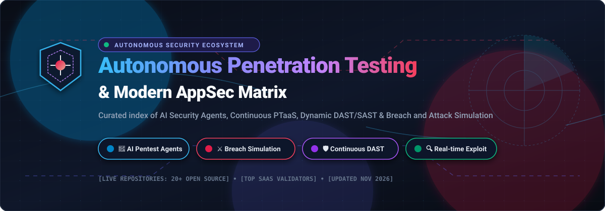

# 🛡️ Awesome Autonomous Penetration Testing & AppSec

  

  
  
  
  
  
  

---

## ⚡ Top Autonomous Penetration Testing, AI Red Teaming & AppSec Ecosystem

> 🎯 **Curated index of SaaS/Hosted Continuous Validation Platforms, Autonomous AI Security Agents, Dynamic DAST/SAST engines, and Open-Source Exploit Tools.**  
> 
> *Targeted at Application Security (AppSec) Engineers, Penetration Testers, DevSecOps Architects, Red/Blue Teams, and Security Researchers.*  
> 
> 📅 **Last updated: November 2026**

---

### 🔍 Search & SEO Metadata
`autonomous-penetration-testing` • `ai-pentesting` • `appsec-automation` • `breach-and-attack-simulation` • `dast-pipeline` • `sast-engine` • `continuous-threat-exposure-management` • `ptaaS` • `red-teaming-agents` • `vulnerability-validation`

This curated repository tracks the bleeding edge of **Autonomous Penetration Testing & AppSec**. Discover, audit, fuzz, exploit, simulate, and validate security vulnerabilities across web applications, APIs, microservices, source code, and multi-cloud infrastructure using autonomous AI security agents, automated red-teaming frameworks, and continuous vulnerability management pipelines.

---

## 📑 Table of Contents

- [📊 Sector Overview & Market Dynamics](#-sector-overview--market-dynamics)
- [🏢 SaaS & Hosted Security Validation Platforms](#-saas--hosted-security-validation-platforms)
- [🔓 Open-Source GitHub Projects (Ranked by Stars)](#-open-source-github-projects-ranked-by-stars)
- [🤝 How to Contribute](#-how-to-contribute)
- [💖 Support & Sponsorship](#-support--sponsorship)
- [📈 Star History](#-star-history)
- [⚠️ Legal & Ethical Disclaimer](#️-legal--ethical-disclaimer)

---

## 📊 Sector Overview & Market Dynamics

The global penetration testing and Breach and Attack Simulation (BAS) market is valued at approximately **$3.5B to $4.2B (2025–2026)**, expanding at an estimated **14% to 28% CAGR** as regulatory mandates (such as DORA, NIS2, and PCI DSS 4.0) accelerate the shift from periodic annual assessments to continuous autonomous validation. The sector is **moderately to highly fragmented** rather than winner-take-all, characterized by a vibrant spectrum of pure-play autonomous AI validation startups, established enterprise BAS platforms, crowdsourced bug-bounty networks, and traditional consultancies aggressively transitioning to PTaaS models.

---

## 🏢 SaaS & Hosted Security Validation Platforms

Below is a breakdown of enterprise hosted solutions, ranked in descending order by company valuation / scale:

| 🏢 Company / Platform | 💰 Company Scale (Valuation / Revenue) | 📝 Description | 🏷️ Starting Pricing | 🎁 Free Tier / Free Trial Limits |
| :--- | :--- | :--- | :--- | :--- |
| **[Horizon3.ai NodeZero](https://horizon3.ai)** | Valuation: ~$2B+ (Series E) / ARR: >$100M | Autonomous penetration testing platform that continuously discovers attack paths, safely exploits vulnerabilities, and verifies remediation across internal, external, and cloud environments. | $15/asset/test (Flex) or $50/asset/year (Core, ~$18,600/yr min contract) | 14-day guided proof of value / 30-day trial (scoped to 1 internal pentest run & select remediation checks) |
| **[Pentera](https://pentera.io)** | Valuation: $1B+ (Unicorn) / ARR: ~$117M | Automated security validation platform performing continuous, agentless real-world attack emulation across web applications, internal networks, and cloud workloads. | Starts at ~$35,000/year (enterprise contracts typically $90k–$120k/yr) | No permanent free tier; guided 1-to-2 week Proof of Concept (PoC) restricted to specific network subnet |
| **[HackerOne](https://hackerone.com)** | Valuation: ~$635M–$829M / Revenue: >$100M+ ARR | Leading crowdsourced security, bug bounty, and AI-assisted code/AppSec vulnerability discovery platform connecting organizations with global ethical hackers. | $8,000/year (Essential VDP platform fee) or $25,000/year (Private Bounty platform fee + 5% bounty fee) | Free forever plan: Essential VDP & Community Edition for OSS projects (unlimited vulnerability intake, safe harbor, no platform fee, exclude cash bounties) |
| **[Cymulate](https://cymulate.com)** | Valuation: $500M (Series D) / ARR: ~$30M–$50M | Cloud-based exposure management and continuous automated red teaming platform validating web applications, APIs, email security, and cloud attack surfaces. | Starts at ~$1,500/feature/month (~$18,000/year; full validation bundles start ~$91,000/yr) | 14-day free trial (full-access evaluation across core attack vectors like email, web gateway, and phishing simulations) |
| **[NetSPI](https://netspi.com)** | Revenue: >$200M combined (with Synack) / $500M KKR funding | Proactive enterprise security platform delivering Attack Surface Management (ASM), Penetration Testing as a Service (PTaaS), and Breach and Attack Simulation. | Custom enterprise quotes (~$30,000–$50,000/year minimum engagement scale) | No self-serve free tier; sales-guided 14-day scoping assessment / demo sandbox with restricted asset scans |
| **[AttackIQ](https://attackiq.com)** | Valuation: ~$215.5M / Revenue: ~$36M | MITRE ATT&CK-aligned security optimization and Breach and Attack Simulation platform for testing defensive detection, WAF/EDR rules, and incident response readiness. | £4,725/unit/year (~$6,000/yr for AttackIQ Flex modular bundles) | Free forever educational access via AttackIQ Academy (labs & certifications); guided 14-day scoped PoC for platform |
| **[Cobalt.io](https://cobalt.io)** | Raised: >$35.5M+ (Highland Europe) / ARR: ~$51M–$130M | Pentest as a Service (PtaaS) platform combining on-demand vetted AppSec researchers with centralized vulnerability management, SLAs, and CI/CD integrations. | $3,500/test (Autonomous Pentest) or credit subscription (~$1,500–$2,000/credit bundle, typically $25k+/yr) | No self-serve free tier; custom guided demo / sample report assessment only (no automated trial execution) |
| **[Picus Security](https://picussecurity.com)** | Raised: >$80M+ ($45M Series C) / ARR: ~$25M–$50M | Continuous security validation and threat-centric exposure management platform pairing automated attack simulation with actionable WAF/SIEM/EDR mitigation rules. | Starts at ~$15,000–$25,000/year based on deployed attack simulation modules | 14-day free trial (restricted deployment to single host agent/specific security controls) |
| **[SafeBreach](https://safebreach.com)** | Raised: $106.5M (Series D) / ARR: ~$21M–$33M | Enterprise Breach and Attack Simulation (BAS) platform executing thousands of continuously updated attack methods to validate application, endpoint, and network defenses. | Starts at ~$30,000–$50,000/year based on IP/agent deployment scope | No public free tier; guided 14-to-30 day Proof of Concept (PoC) restricted to designated target endpoints/sandbox |
| **[BreachLock](https://breachlock.com)** | Raised: ~$3.1M / ARR: ~$15M–$17.3M | Cloud-native Penetration Testing as a Service (PTaaS) platform uniting AI-assisted automated scanning with human-led application and API penetration testing. | $2,500/test (1-Time Security Validation) or $5,000/year (Annual Security Validation) | No self-serve free tier; guided interactive demo & limited sample asset scan (1 target asset/domain) |

---

## 🔓 Open-Source GitHub Projects (Ranked by Stars)

All projects below are open-source and sorted in **descending order by GitHub stargazers**. Each project features an official live badge linking directly to its stargazer community.

1. **[usestrix/strix](https://github.com/usestrix/strix)**   
   🤖 Autonomous open-source AI penetration testing agents that dynamically execute code, crawl web applications, identify zero-days/flaws, and autonomously construct verifiable exploit proof-of-concepts (PoCs).

2. **[KeygraphHQ/shannon](https://github.com/KeygraphHQ/shannon)**   
   🧠 Fully autonomous open-source AI penetration tester for web applications and APIs. Runs simultaneous source-code analysis and live dynamic testing to uncover exploitable logic and AppSec flaws.

3. **[mitmproxy/mitmproxy](https://github.com/mitmproxy/mitmproxy)**   
   🔄 Interactive TLS-capable intercepting HTTP/HTTPS proxy with versatile Python scripting APIs for automated traffic manipulation, API fuzzing, and penetration testing orchestration.

4. **[aquasecurity/trivy](https://github.com/aquasecurity/trivy)**   
   📦 Comprehensive open-source security scanner discovering vulnerabilities, misconfigurations, secrets, and SBOM exposures in containers, Kubernetes, code repositories, and clouds.

5. **[sqlmapproject/sqlmap](https://github.com/sqlmapproject/sqlmap)**   
   💉 Premier open-source penetration testing tool that automates the detection and exploitation of SQL injection flaws and full database server takeovers.

6. **[projectdiscovery/nuclei](https://github.com/projectdiscovery/nuclei)**   
   ⚡ Ultra-fast, highly customizable vulnerability scanner driven by a massive community-driven YAML template engine for detecting CVEs, exposures, and zero-days across web and cloud targets.

7. **[gitleaks/gitleaks](https://github.com/gitleaks/gitleaks)**   
   🔑 High-performance SAST tool and pre-commit scanner designed to detect and prevent hardcoded secrets, API tokens, and private keys in Git repositories.

8. **[semgrep/semgrep](https://github.com/semgrep/semgrep)**   
   🔎 Fast, lightweight Static Application Security Testing (SAST) engine that enforces custom security rules and pattern matches across complex codebases directly within CI/CD PR checks.

9. **[GreyDGL/PentestGPT](https://github.com/GreyDGL/PentestGPT)**   
   🕹️ LLM-powered penetration testing agentic framework designed to guide ethical hackers and red-team operators through interactive reconnaissance, vulnerability discovery, and exploit construction.

10. **[zaproxy/zaproxy](https://github.com/zaproxy/zaproxy)**   
    🌐 OWASP ZAP (ZED Attack Proxy) — the world's most widely used open-source web application security scanner and DAST framework for automated DevSecOps pipelines.

11. **[OWASP/Amass](https://github.com/OWASP/Amass)**   
    🗺️ In-depth attack surface mapping, external asset discovery, and network reconnaissance tool using open-source information gathering and active graph database techniques.

12. **[redcanaryco/atomic-red-team](https://github.com/redcanaryco/atomic-red-team)**   
    💥 Extensive open-source library of simple, automated detection tests mapped directly to the MITRE ATT&CK framework for validating defensive controls, EDR, and SIEM rules.

13. **[aliasrobotics/cai](https://github.com/aliasrobotics/cai)**   
    🤖 Modular AI security framework empowering autonomous agents with native Kali Linux tooling, terminal execution, and multi-agent coordination for offensive and defensive testing.

14. **[securego/gosec](https://github.com/securego/gosec)**   
    🔍 Security code checker and SAST scanner inspecting Go AST source trees to identify common AppSec vulnerabilities, memory issues, and crypto misconfigurations.

15. **[mitre/caldera](https://github.com/mitre/caldera)**   
    🎯 Flagship open-source cyber adversary emulation and Breach & Attack Simulation (BAS) system built on the MITRE ATT&CK matrix for continuous automated blue-team validation.

16. **[hahwul/dalfox](https://github.com/hahwul/dalfox)**   
    🦊 Powerful, blazing-fast open-source parameter analysis and Cross-Site Scripting (XSS) scanner with DOM verification and advanced payload generation engines.

17. **[DefectDojo/django-DefectDojo](https://github.com/DefectDojo/django-DefectDojo)**   
    📊 Open-source DevSecOps orchestration, vulnerability management, and correlation platform connecting SAST, DAST, SCA, and pentesting findings into unified dashboards.

18. **[schemathesis/schemathesis](https://github.com/schemathesis/schemathesis)**   
    📑 Modern specification-based (OpenAPI/GraphQL) property testing and autonomous API fuzzing tool catching crashes, broken auth, and logic bugs before production.

19. **[t3l3machus/hoaxshell](https://github.com/t3l3machus/hoaxshell)**   
    🐚 Advanced payload generation and reverse-shell handling platform designed for testing EDR evasion and perimeter application filters.

20. **[ghostsecurity/reaper](https://github.com/ghostsecurity/reaper)**   
    👻 Modern validation proxy and AppSec testing tool integrating active exploration with automated exposure detection for web applications and APIs.

---

### 🧩 Recommended Custom Autonomous Architecture

For teams engineering custom autonomous AppSec pipelines:
1. **Recon & Attack Surface**: Combine **OWASP Amass** and **projectdiscovery/nuclei** for external mapping.
2. **Autonomous Exploitation**: Deploy **usestrix/strix** or **KeygraphHQ/shannon** for deep AI agentic penetration testing.
3. **Continuous Code Security**: Enforce **semgrep** and **gitleaks** as mandatory pre-merge CI/CD gates.
4. **Adversary Emulation**: Schedule **mitre/caldera** and **atomic-red-team** tests against staging environments.
5. **Unified Dashboard**: Aggregate and deduplicate all findings in **DefectDojo**.

---

## 🤝 How to Contribute

Contributions, project submissions, and suggestions are welcome!

1. 🍴 **Fork this repository**.
2. 🌿 Create your feature branch (`git checkout -b feature/awesome-addition`).
3. 📝 Add or update entries (please preserve descending star/scale order and provide exact starting pricing / free tier limits).
4. 🚀 Commit your changes (`git commit -m 'feat: add new autonomous agent project'`).
5. 📤 Push to the branch (`git push origin feature/awesome-addition`).
6. 🎯 Open a **Pull Request** with a brief summary of the project.

---

## 💖 Support & Sponsorship

Thank you so much for exploring and supporting the **Awesome Autonomous Penetration Testing & AppSec** initiative! Maintaining this ecosystem guide requires continuous verification, testing of emerging autonomous tools, and staying on top of security developments.

If you find this repository valuable to your work, studies, or organization:
- ⭐ **Star this repository** to improve visibility across the cybersecurity community.
- 🍴 **Fork & Share** it with colleagues on LinkedIn, X/Twitter, Reddit, and Discord.
- ☕ **Buy me a coffee & become a Sponsor**: Support ongoing maintenance directly on the [GitHub Sponsors Dashboard](https://github.com/sponsors/ishandutta2007). Sponsors receive profile badges, repository shoutouts, and priority evaluation for submissions!

---

## 📈 Star History

---

## ⚠️ Legal & Ethical Disclaimer

- **Strict Authorization Required**: All tools, agents, and techniques cataloged in this repository are intended **strictly for authorized penetration testing, academic security research, and internal defensive verification**. Executing offensive security tools or autonomous agents against targets without explicit, documented authorization from the asset owner is illegal and unethical.
- **Safe Environments**: Always confine autonomous offensive AI agents to isolated staging environments or tightly scoped IP/domain allowlists equipped with strict rate-limiting and kill-switches.
- **No Endorsement**: Listings in this repository do not constitute an official endorsement or security guarantee of third-party software or services.

---

  <b>Built with ❤️ for AppSec engineers, ethical hackers, red/blue teams, and autonomous AI security researchers.</b>

